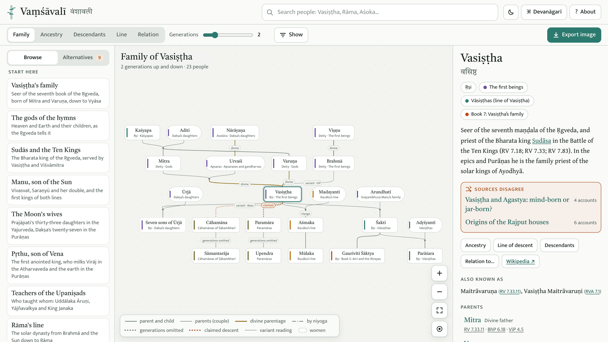
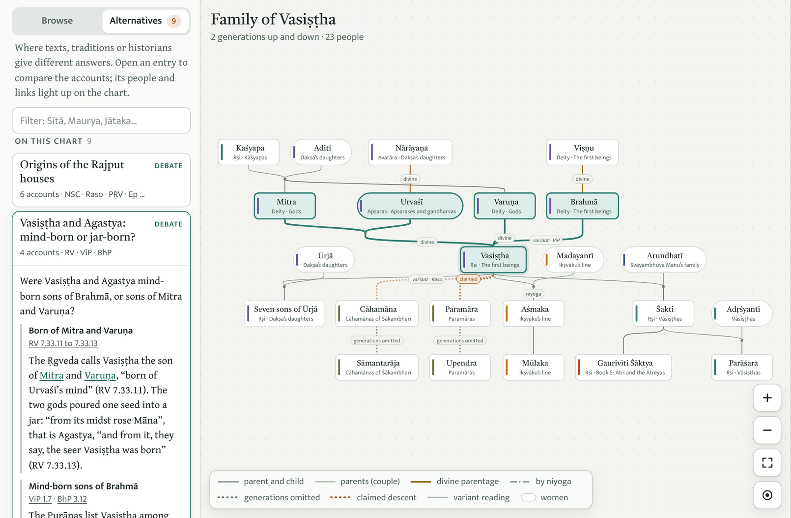
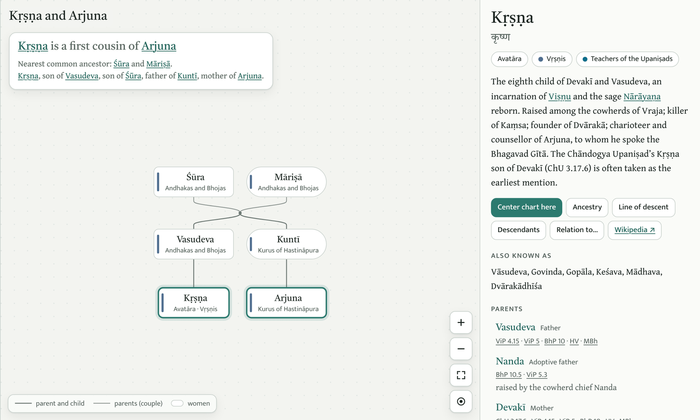

  

<h1 align="center">Vaṃśāvalī</h1>

  <b>वंशावली</b> 
  An interactive, searchable explorer of the family lines of Indian tradition, 
  from the seers of the Ṛgveda to the historical dynasties, with a source for every link.

  <a href="#open-it">Open it</a> ·
  <a href="#which-text-comes-first">Which text comes first</a> ·
  <a href="#change-the-data">Change the data</a> ·
  <a href="#sources-and-credits">Sources and credits</a>

<picture>
  <source media="(prefers-color-scheme: dark)" srcset="assets/screenshot-dark.png">
  
</picture>

## What it is

*Vaṃśa* is a bamboo cane and, like a cane that grows joint by joint, a family line. A *vaṃśāvalī* is a genealogy. This explorer follows the families of Indian tradition as the Hindu texts tell them: the gods and seers of the Vedas, the teachers of the Upaniṣads, the solar and lunar dynasties of the epics and Purāṇas, the Kali-age kings the Purāṇas foretell, and the historical houses that traced themselves back to them.

- **Over 2,000 people, every link cited.** Each person, parent, teacher and marriage carries the passages that state it, and a citation opens the passage in a public translation where one is online.
- **Five views.** Family, Ancestry, Descendants, Line (one line of fathers climbed to its root, numbered generation by generation) and Relation (how any two people are kin, and through whom).
- **The oldest text comes first.** Where the texts disagree, the Vedas give the main line, the Ṛgveda first. Later readings are drawn faded and labelled with the text that gives them.
- **Disagreements side by side.** The Alternatives panel holds over 30 written-up debates, such as whether Vasiṣṭha was born of Mitra and Varuṇa or of Brahmā's mind, and lists everyone whose parents differ between texts or whose descent a later house claimed.
- **Teachers and pupils.** The lines of teachers in the Upaniṣads and Brāhmaṇas are drawn as green dashed links.
- **Devanāgarī, export and themes.** Names can be shown in Devanāgarī, any chart can be saved as PNG or SVG, and there are light and dark themes. It works on phones too.
- **One file.** The whole explorer, data included, is a single HTML page. There is no server and nothing to install.

## A closer look

<picture>
  <source media="(prefers-color-scheme: dark)" srcset="assets/debate-dark.png">
  
</picture>

The Alternatives panel sets the accounts side by side, the Ṛgveda's first, and lights up the people each one names.

<picture>
  <source media="(prefers-color-scheme: dark)" srcset="assets/relation-dark.png">
  
</picture>

Relation finds how two people are kin: Kṛṣṇa and Arjuna are first cousins through Śūra and Māriṣā. Every parent on the right lists its sources.

## Open it

Open `vamshavali.html` in any modern browser. It is one file with all the data inside, so it opens straight from disk and can be hosted anywhere. It loads its fonts from Google Fonts and its chart-layout library, [dagre](https://github.com/dagrejs/dagre), from jsDelivr. Without a connection it still works, with plainer fonts and a simpler layout.

The page opens in light mode. The moon button in the header switches to dark mode, and the browser remembers the choice.

Every view has its own address, so a chart can be bookmarked or shared. The address bar always shows the current one:

| Address | Shows |
| --- | --- |
| `vamshavali.html#vasishtha` | Vasiṣṭha's family, two generations up and down |
| `vamshavali.html#rama-ancestry-6` | Rāma's ancestry, six generations back |
| `vamshavali.html#rama-line` | Rāma's line, 67 generations from Viṣṇu |
| `vamshavali.html#krishna-relation-arjuna` | How Kṛṣṇa and Arjuna are related |

## Which text comes first

Where the texts disagree about a parent, the chart draws the oldest witness as the main line and the others as faded variant readings, each labelled with the text that gives it:

1. the four Vedas, in their order: the Ṛgveda, the Yajurveda, the Sāmaveda and the Atharvaveda (their Saṃhitās)
2. the Upaniṣads
3. the Brāhmaṇas and the other Vedic texts (the Ṛgveda Anukramaṇī, the Bṛhaddevatā and the Nirukta)
4. the epics, the Purāṇas, and later Sanskrit and historical sources

The Sāmaveda's verses are nearly all taken from the Ṛgveda, so the Ṛgveda is cited for them. 

The debates under Alternatives list their accounts in the same order, so a Vedic account always comes first. The build checks this: it warns whenever a data file lets a later text override a Vedic one, unless a written-up debate covers the case.

## Jain, Buddhist and Sikh traditions

These lineages are kept, but as an optional view, because they are not primary texts here: about 300 more people, from the first kings of the Pāli chronicles and the Śākyas to the Jain Tīrthaṅkaras and the Sikh Gurus. They are hidden until the switch "Jain, Buddhist and Sikh traditions" under **Show** is turned on. While they are hidden, their people, links, readings and debates are left out of the chart, the search and the sidebar. A search that matches someone in them offers to turn them on, and a link straight to one of their people turns them on by itself.

## Sources and credits

The citations open these public translations:

- I had an early version of this internally created few weeks back but it was lagging in proper primary sources and it went into cold bag until, [Pramana portal](https://indike.org/pramana/) created by [@real_mahalingam](https://x.com/real_mahalingam) caught my eye recently. This is amazing work and it became new funnel for the primary resources. 

- R. T. H. Griffith's Ṛgveda and Atharvaveda, H. H. Wilson's Viṣṇu Purāṇa and K. M. Ganguli's Mahābhārata, at [sacred-texts.com](https://sacred-texts.com/hin/)
- F. Max Müller's Upaniṣads (Sacred Books of the East 1 and 15), A. B. Keith's Taittirīya Saṃhitā and Julius Eggeling's Śatapatha Brāhmaṇa, also at sacred-texts.com
- the Bhāgavata Purāṇa at [Vedabase](https://vedabase.io/en/library/sb/), the Vālmīki Rāmāyaṇa at [IIT Kanpur](https://valmiki.iitk.ac.in/) and the Pāli canon at [SuttaCentral](https://suttacentral.net/)

Inscriptions and historical figures link to Wikipedia. The full list of sources, with links, is in `data/sources.txt` and under **About** in the page.

The page uses the fonts [Tiro Devanagari Sanskrit](https://fonts.google.com/specimen/Tiro+Devanagari+Sanskrit), [Gentium Book Plus](https://fonts.google.com/specimen/Gentium+Book+Plus) and [Mukta](https://fonts.google.com/specimen/Mukta), all under the SIL Open Font License, and lays out its charts with [dagre](https://github.com/dagrejs/dagre) (MIT License).

## Limits

This is a reading aid built from the texts, not a critical edition. Dates for early kings are approximate, Purāṇic king lists are not history, and many names occur in several families, so check a person's house and sources before drawing conclusions. Devanāgarī spellings are generated from the romanised names and may differ from customary spellings, especially for Tamil, Kannada and Punjabi names.
